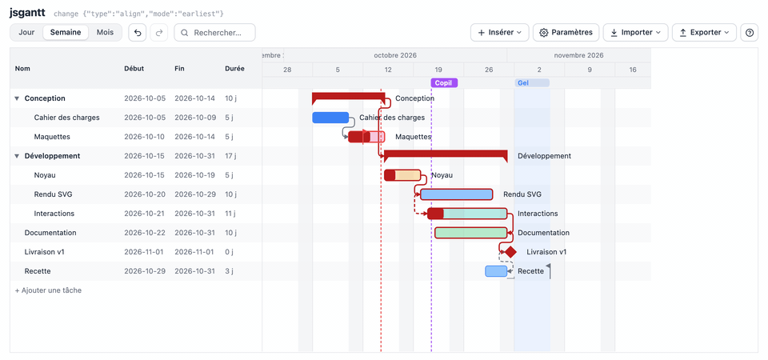
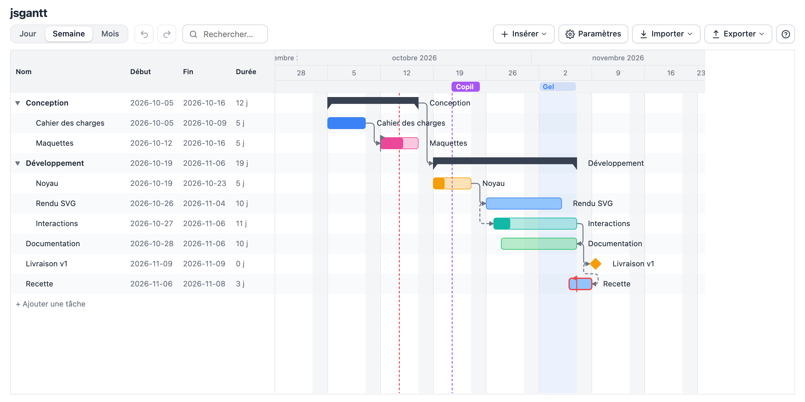
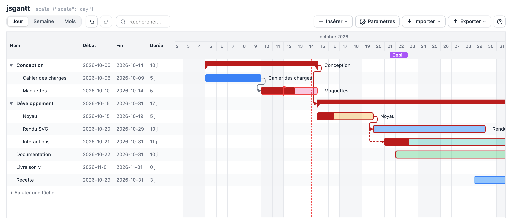
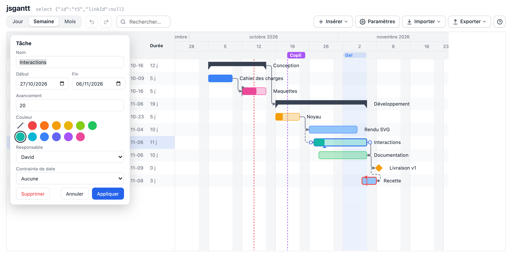
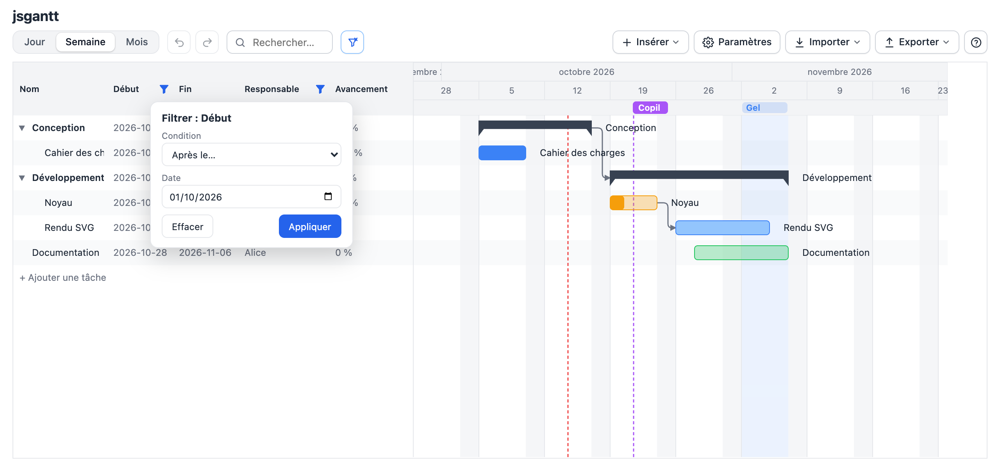
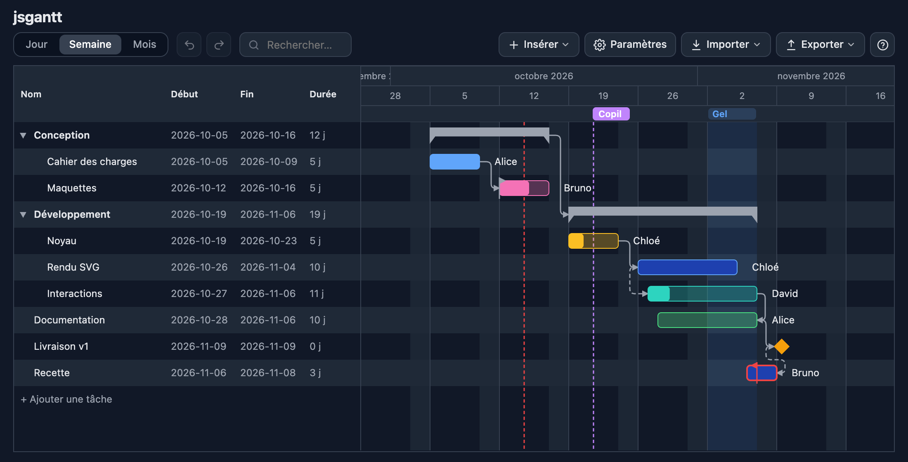
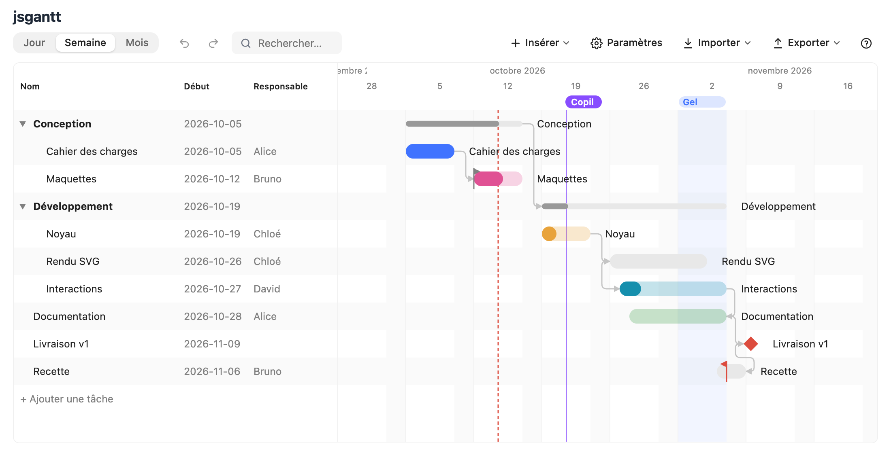
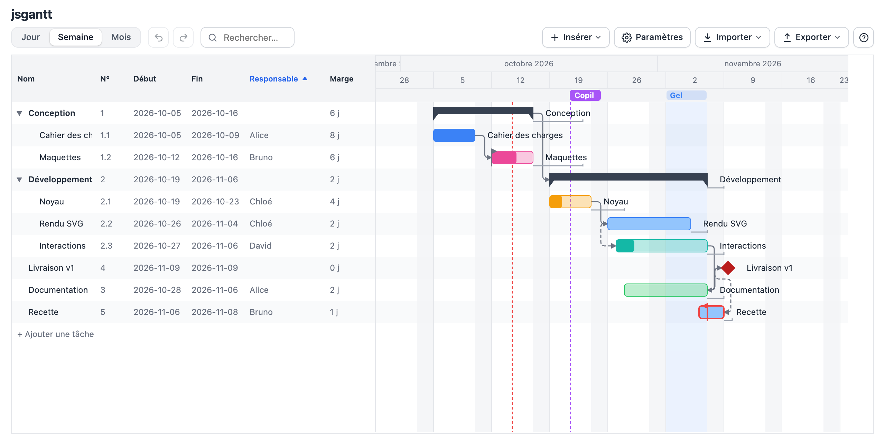
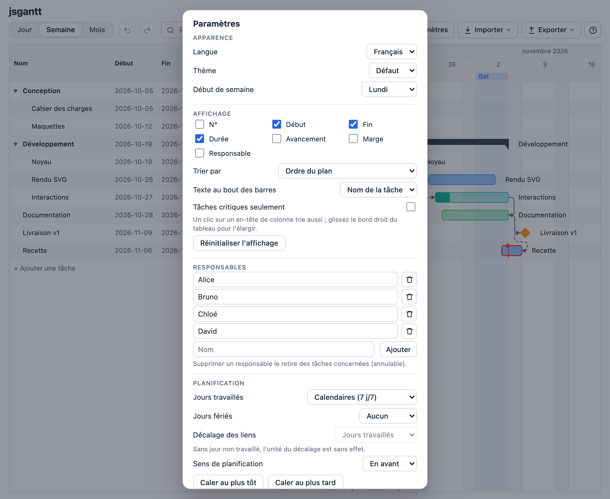
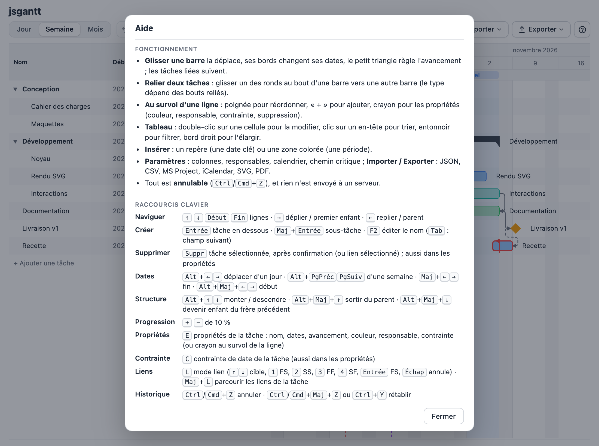

> [!WARNING]
> Ce projet a été vibecodé avec l’aide de l’intelligence artificielle.

# jsgantt

Une bibliothèque JavaScript pour dessiner des **diagrammes de Gantt interactifs**, en SVG, dont tout le design est
piloté par **CSS**. Tâches, groupes, dépendances à la manière de Merlin Project, calendriers ouvrés, chemin critique,
filtres, exports PDF, CSV, iCalendar et MS Project… sans aucune dépendance ni étape de construction.

**Essayer la démo :** `npm run demo`, puis http://localhost:8000/demo/index.html (voir « Démarrage »).

Rien n'est envoyé à un serveur : tout se passe dans le navigateur.

## Aperçu



| La démo | Chemin critique et marges |
|---|---|
|  |  |

| Propriétés d'une tâche | Filtres par colonne |
|---|---|
|  |  |

| Thème sombre | Thème « Épure » | Colonnes, tri et marges |
|---|---|---|
|  |  |  |

---

# Pour tout le monde

## Le projet en bref

Un **diagramme de Gantt** montre un projet comme une liste de tâches posées sur une ligne de temps : chaque tâche est
une barre, de sa date de début à sa date de fin, et des flèches relient les tâches qui dépendent les unes des autres
(« le code commence quand les maquettes sont finies »). jsgantt dessine ces diagrammes dans une page web et permet de
les modifier directement à la souris ou au clavier : déplacer une barre repousse automatiquement les tâches qui en
dépendent.

Particularité : **l'apparence est entièrement réglée par CSS** (couleurs, tailles, polices, formes). On change de thème
sans toucher au code ; trois thèmes sont fournis (clair, sombre, et « Épure », aux barres en pilule).

## Utiliser la démo

| Paramètres | Aide (bouton « ? ») |
|---|---|
|  |  |

- **Barre d'outils** : échelle (jour, semaine, mois), annuler et rétablir, recherche dans les noms, menu **Insérer**
  (repère ou zone colorée), **Paramètres**, **Importer**, **Exporter** et **?** (aide : fonctionnement résumé et
  raccourcis clavier, aussi avec la touche `?`). La dernière action s'affiche à côté du titre ; le diagramme occupe
  toute la hauteur de la fenêtre.
- **Tâches** : glisser une barre la déplace, glisser ses bords change ses dates, le petit triangle sous la barre règle
  l'avancement. Double-clic sur une cellule du tableau pour la modifier. Au survol d'une ligne : poignée (réordonner,
  ou glisser au milieu d'une ligne pour en faire une sous-tâche), « + » (ajouter en dessous) et crayon (propriétés).
- **Propriétés d'une tâche** (crayon ou touche `E`) : nom, dates, avancement, **couleur** (12 au choix),
  **responsable**, contrainte de date et **Supprimer** (avec confirmation, sous-tâches comprises).
- **Dépendances** : glisser un des petits ronds au bout d'une barre vers une autre barre. Le type dépend des bouts reliés
  (fin → début, début → début, fin → fin, début → fin). Clic sur une flèche puis `Suppr` pour la retirer.
- **Groupes** : une tâche qui a des sous-tâches devient un groupe, dont les dates suivent celles de ses enfants. Le
  chevron le replie.
- **Repères et zones** : un repère marque une date (comité, mise en production) ; une zone colore une période (congés,
  gel). On glisse un repère pour le déplacer, un clic sur une étiquette l'édite.
- **Tableau** : on choisit ses colonnes (N°, Début, Fin, Durée, Avancement, Marge, Responsable), un clic sur un en-tête
  trie, l'**entonnoir** qui apparaît au survol filtre la colonne (périodes « cette semaine », « mois prochain »…,
  « avant le », « après le », « entre », responsables, avancement…). On élargit le tableau en glissant son bord droit.
- **Paramètres** : langue (français, anglais), thème, début de semaine, colonnes et tri, texte au bout des barres,
  liste des **responsables**, jours travaillés (7 j/7, ouvrables, ouvrés), jours fériés (France, États-Unis), sens de
  planification, calages au plus tôt ou au plus tard, **chemin critique**, lecture seule.
- Tout est **annulable** (`Ctrl`/`Cmd` + `Z`), y compris un import. La démo se souvient de l'affichage choisi.

### Raccourcis clavier

Quand le diagramme a le focus (clic dans le tableau ou `Tab`). La liste est aussi dans l'aide de la démo (bouton « ? ») :

| Groupe | Touches | Effet |
|---|---|---|
| Naviguer | `↑` `↓` `Début` `Fin` | Changer de ligne |
| | `→` / `←` | Déplier ou aller au premier enfant / replier ou aller au parent |
| Créer | `Entrée` / `Maj` + `Entrée` | Tâche en dessous / sous-tâche (le nom s'édite aussitôt) |
| Modifier | `F2` | Éditer le nom (`Tab` : colonne suivante) |
| | `E` | Propriétés de la tâche |
| | `C` | Contrainte de date |
| | `+` / `-` | Avancement de ±10 % |
| Dates | `Alt` + `←` `→` | Déplacer d'un jour (`Alt` + `PgPréc` `PgSuiv` : d'une semaine) |
| | `Maj` + `←` `→` | Changer la fin d'un jour |
| | `Alt` + `Maj` + `←` `→` | Changer le début d'un jour |
| Structure | `Alt` + `↑` `↓` | Monter, descendre |
| | `Alt` + `Maj` + `↑` / `↓` | Sortir du groupe / entrer dans la tâche du dessus |
| Liens | `L` | Mode lien : `↑` `↓` choisissent la cible, `1` à `4` le type, `Entrée` valide, `Échap` annule |
| | `Maj` + `L` | Parcourir les liens de la tâche, puis `Suppr` pour en retirer un |
| Supprimer | `Suppr` | La tâche (après confirmation) ou le lien sélectionné |
| Historique | `Ctrl`/`Cmd` + `Z`, `Ctrl`/`Cmd` + `Maj` + `Z` | Annuler, rétablir |

### Importer, exporter, imprimer

| Format | Export | Import | Pour quoi faire |
|---|---|---|---|
| **JSON** | oui | oui | Sauvegarder et recharger un planning complet (tout est conservé) |
| **CSV** | oui | oui | Échanger avec un tableur (Excel, Numbers, LibreOffice) ; en-têtes français ou anglais, dates `AAAA-MM-JJ` ou `JJ/MM/AAAA` |
| **MS Project (XML)** | oui | oui | Ouvrir le planning dans MS Project, Merlin Project, ProjectLibre, OmniPlan… |
| **iCalendar (.ics)** | oui | non | Voir les tâches dans un agenda (Google Agenda, Outlook, Calendrier) |
| **SVG**, **PDF** | oui | non | Image vectorielle, document à partager |
| **Impression** | | | Le diagramme entier, adapté à la page |

Un fichier invalide est refusé avec un message précis (ligne du CSV comprise) et rien n'est modifié ; ce qui ne peut pas
être repris (une couleur inconnue, une contrainte non prise en charge) est signalé.

### Limites

- Les durées se comptent en **jours** (pas d'heures).
- Un seul responsable par tâche ; pas de gestion de charge ni de coûts.
- MS Project : le format binaire `.mpp` n'est pas lu (l'enregistrer en XML depuis MS Project) ; les couleurs ne
  passent pas, et une tâche sans contrainte est exportée avec « Début au plus tôt » à sa date (pour que MS Project ne la
  déplace pas).
- Les **contraintes de dates** sont indicatives : elles signalent un écart, elles ne déplacent rien.
- Pas encore de paquet npm ni de composants pour React ou Vue.

---

# Pour les développeurs

## Démarrage

Prérequis : Node.js 22 ou plus récent (pour les tests et la démo ; la bibliothèque elle-même n'a besoin que d'un navigateur).

```bash
npm run demo              # sert la démo sans cache : http://localhost:8000/demo/index.html (PORT=… pour changer)
npm test                  # tests unitaires (runner natif de Node)
npm run capture:readme    # régénère les images du README (docs/images/) : Chrome et ffmpeg requis
```

Les ES modules exigent un serveur HTTP. Avec `python3 -m http.server`, le navigateur peut garder d'anciennes versions des
modules : recharger sans cache (`Ctrl`/`Cmd` + `Maj` + `R`).

```html
<link rel="stylesheet" href="src/gantt.css">
<div id="chart"></div>
<script type="module">
  import { Gantt } from './src/gantt.js';
  const gantt = new Gantt(document.getElementById('chart'), {
    scale: 'week', // 'day' | 'week' | 'month'
    tasks: [
      { id: 'a', name: 'Conception', start: '2026-10-05', end: '2026-10-09', progress: 0.5, color: 'blue' },
      { id: 'b', name: 'Réalisation', start: '2026-10-12', end: '2026-10-20' },
      { id: 'm', name: 'Livraison', start: '2026-10-21', milestone: true },
    ],
    links: [
      { from: 'a', to: 'b', type: 'FS' },
      { from: 'b', to: 'm', type: 'FS', lag: 0 },
    ],
  });
</script>
```

## Technologies

JavaScript vanilla en ES modules, sans framework, sans build, sans dépendance. Rendu **SVG** stylé par classes et
variables CSS. Tests avec `node:test`. Le PDF charge [jsPDF](https://github.com/parallax/jsPDF) et
[svg2pdf.js](https://github.com/yWorks/svg2pdf.js) à la demande (option `pdfLibs` pour fournir ses propres copies). Les
images du README sont produites en pilotant Chrome par le protocole DevTools (WebSocket intégré à Node), sans
dépendance non plus.

## Organisation du code

Le cœur (modèle, planification, calculs, formats) ne touche jamais au DOM et est testé sous Node ; le rendu et les
interactions s'appuient dessus.

| Fichier | Rôle |
|---|---|
| `src/gantt.js` | Façade `Gantt` : état, rendu, historique, vue, API publique. |
| `src/model.js` | Tâches, liens, hiérarchie, responsables, repères et zones, validation, (dé)sérialisation. |
| `src/scheduler.js` | Planification en avant et en arrière (4 types de liens, décalage, groupes). |
| `src/slack.js` | Dates au plus tard, marges totale et libre, chemin critique. |
| `src/calendar.js`, `src/constraints.js` | Jours ouvrés et fériés ; contraintes de dates (indicatives). |
| `src/view.js` | Colonnes, tri entre sœurs, recherche et filtres par colonne (périodes relatives). |
| `src/timescale.js`, `src/renderer.js` | Échelle de temps ; mise en page pure (`computeLayout`) puis SVG (`renderParts`). |
| `src/interactions.js`, `src/keyboard.js`, `src/keynav.js` | Souris, clavier, navigation. |
| `src/a11y.js`, `src/i18n.js` | Accessibilité (treegrid, annonces) ; localisation et codes d'erreur. |
| `src/task-editor.js`, `src/filter-editor.js`, `src/annotation-editor.js`, `src/constraint-editor.js`, `src/confirm.js` | Petites fenêtres d'édition et de confirmation. |
| `src/formats/` | `csv.js`, `ical.js`, `mspdi.js` (MS Project XML), `xml.js` (lecteur XML minimal). |
| `src/export.js` | SVG autonome, PDF, téléchargements. |
| `src/gantt.css`, `src/themes/epure.css` | Thème par défaut (et sombre), thème Épure. |
| `demo/index.html` | Page de démonstration complète. |
| `scripts/` | `serve.mjs` (serveur sans cache), `capture-readme.mjs` (images du README). |
| `test/` | Tests unitaires (modèle, planification, marges, vue, filtres, formats, mise en page, accessibilité…). |

## Données

**Tâche** : `id` (obligatoire), `name`, `start` et `end` (`AAAA-MM-JJ`, fin incluse, obligatoires sauf pour un groupe), `progress` (0 à 1), `parentId`, `collapsed`, `milestone` (jalon : `end` facultatif), `className`, `color` (une des 12 couleurs, voir « Couleurs et responsables »), `owner` (id d'un responsable de la liste `owners`), `data` (objet libre, conservé dans le JSON, modifiable avec `g.model.updateTask(id, { data })` ; utile aux colonnes personnalisées).
Par défaut, le tableau affiche le nom, le début, la fin et la **durée en jours** (jours travaillés si un calendrier est défini, calendaires sinon ; 0 pour un jalon ; un groupe affiche la durée de son étendue). Cette colonne est en lecture seule ; `g.model.durationDays(id)` donne la même valeur.

Une tâche qui a des enfants est un **groupe** : ses dates sont calculées à partir de ses enfants.

**Lien** : `from`, `to`, `type` (`FS`, `SS`, `FF`, `SF`), `lag` (jours, négatif = avance), `id` facultatif.

| Type | Contrainte sur la cible B |
|---|---|
| FS | `start(B) ≥ end(A) + 1 + lag` |
| SS | `start(B) ≥ start(A) + lag` |
| FF | `end(B) ≥ end(A) + lag` |
| SF | `end(B) ≥ start(A) - 1 + lag` |

Ajouter une tâche sous une tâche simple en fait un groupe (ses dates deviennent celles de ses enfants) ; retirer le dernier enfant d'un groupe le rend à nouveau simple, avec ses dernières dates. Un déplacement qui créerait un cycle ou un lien interdit entre un groupe et un de ses descendants est refusé.

Planification en avant : une tâche n'est jamais avancée, seulement repoussée. Un lien vers un groupe décale tout le groupe. Les cycles et les liens entre un groupe et un de ses descendants sont refusés. Un import invalide lève une exception avec un message précis.

## API

```js
const g = new Gantt(el, { tasks, links, scale, readonly, pdfLibs, historyLimit, locale, weekStart, calendar, planning, showCritical,
  columns, sort, filter, filters, tableWidth, barLabel, markers, zones, owners, confirmDelete });
g.on('change' | 'select' | 'invalid' | 'scale' | 'history', handler); // retourne une fonction de désabonnement
g.undo(); g.redo();     // annuler / rétablir ; g.canUndo et g.canRedo (faux en lecture seule)
g.addTask({ name, start, end, parentId, afterId }); // sans start : jour au centre de la vue ; durée par défaut 3 jours
g.removeTask(id);        // supprime la tâche, ses descendants et leurs liens (sans confirmation)
g.confirmRemoveTask(id); // même chose après confirmation (option confirmDelete, vraie par défaut)
g.moveTaskTo(id, { parentId, beforeId }); // réordonne ou change de parent
// ces trois méthodes renvoient { ok, … } ; refusées en lecture seule ou si le résultat est invalide
g.setScale('month');
g.setLocale('en');        // change la langue à chaud (voir « Localisation »)
g.setCalendar({ workingDays: [1, 2, 3, 4, 5], holidays: [], lagUnit: 'working' }); // ou null : 7 jours sur 7 ; replanifie, annulable
g.setWeekStart(0);       // 0 = dimanche, 1 = lundi
g.setConstraint(id, { type: 'SNET', date: '2026-10-12' }); // ou null ; annulable (voir « Contraintes de dates »)
g.setPlanning({ direction: 'backward', end: '2026-11-30' }); // ou null : en avant ; annulable (voir « Planification »)
g.alignEarliest(); g.alignLatest();  // cale les tâches reliées au plus tôt / au plus tard ; annulable
g.setColumns(['wbs', 'start', 'end', 'progress']); g.setSort({ column: 'start', dir: 'asc' }); g.setFilter('recette');
g.setColumnFilter('start', { period: 'thisWeek' }); g.clearFilters(); g.editColumnFilter('owner');
g.getView(); g.setView({ columns, sort, filter, filters, tableWidth, barLabel, scale }); // voir « Affichage »
g.updateTaskProps(id, { name, start, end, progress, color, owner, constraint }); g.editTask(id); // tout ou rien, annulable
g.setOwners([{ id, name }]); g.addOwner(name); g.renameOwner(id, name); g.removeOwner(id);
g.addMarker({ date, label, color }); g.updateMarker(id, patch); g.removeMarker(id); g.editMarker(id);
g.addZone({ start, end, label, color }); g.updateZone(id, patch); g.removeZone(id); g.editZone(id); // voir « Repères et zones »
g.setShowCritical(true); // affiche le chemin critique et les marges (voir « Chemin critique et marges »)
g.model.slack();         // Map id → { total, free, lateStart, lateEnd, critical } ; g.model.criticalIds()
g.getData();            // { tasks, links } au format JSON
g.setData(data);        // remplace le planning et vide l'historique (lève avant toute modification si invalide)
g.importData(data); g.importCSV(texte); g.importMSProject(texte); // remplacent le planning, annulables (voir « Formats d'échange »)
g.exportCSV(filename?); g.exportICS(filename?); g.exportMSProject(filename?);
g.exportSVG(filename?); // télécharge et retourne la chaîne SVG ; filename = null : pas de téléchargement
g.exportJSON(filename?);
await g.exportPDF(filename?);
g.print();
g.destroy();
```

## Événements

`change` (détail : `type` parmi `move`, `resize`, `progress`, `link`, `unlink`, `rename`, `dates`, `add`, `remove`, `reorder`, `calendar`, `constraint`, `planning`, `align` (avec `mode`), `props` (propriétés d'une tâche), `owners` (avec `action` et `ownerId`), `marker` et `zone` (avec `action` : `add`, `update`, `remove`, et `markerId` / `zoneId`), `import`, `collapse`, `undo`, `redo`, plus `id` d'une tâche ou `linkId` d'un lien), `select`, `invalid` (`reason` traduit et `code` stable), `scale`, `history`, `locale` (`canUndo`, `canRedo`).
L'historique garde `historyLimit` étapes (100 par défaut) ; `setData` le vide.

## Interactions

Glisser une barre (déplace), ses bords (redimensionne), le triangle sous la barre (progression) ; glisser une ancre ronde vers une autre barre (crée un lien, le type dépend des ancres) ; clic sur un lien puis `Suppr` ; chevron pour replier ; ligne « + Ajouter une tâche » en bas du tableau, et au survol d'une ligne : poignée (glisser pour réordonner : trait entre deux lignes = même niveau, milieu d'une ligne = en faire un enfant), « + » (ajoute en dessous), crayon (propriétés de la tâche, où se trouve aussi « Supprimer ») ; `Suppr` supprime la tâche sélectionnée après confirmation (ou le lien sélectionné), annulable ; double-clic sur une cellule du tableau pour éditer ; `Ctrl`/`Cmd` + `Z` annule, `Ctrl`/`Cmd` + `Maj` + `Z` ou `Ctrl` + `Y` rétablit (le repli d'un groupe n'est pas annulable) ; `Ctrl`/`Cmd` + molette pour zoomer ; `Échap` annule un glissement.

## Styles

Tout le design passe par CSS. Variables principales (définies sur `.gantt-root`) :

| Variable | Rôle |
|---|---|
| `--gantt-font`, `--gantt-font-size` | Typographie |
| `--gantt-bg`, `--gantt-text`, `--gantt-text-muted`, `--gantt-border` | Couleurs de base |
| `--gantt-row-alt`, `--gantt-weekend`, `--gantt-header-bg`, `--gantt-today-color` | Grille |
| `--gantt-bar-bg`, `--gantt-bar-stroke`, `--gantt-progress-bg`, `--gantt-bar-radius` | Barres |
| `--gantt-group-bg`, `--gantt-milestone-bg` | Groupes, jalons |
| `--gantt-link-color`, `--gantt-link-width`, `--gantt-link-selected` | Liens |
| `--gantt-selected`, `--gantt-invalid` | États |
| `--gantt-critical`, `--gantt-slack` | Chemin critique, traits de marge |
| `--gantt-row-height`, `--gantt-bar-height`, `--gantt-header-height`, `--gantt-table-width`, `--gantt-date-col-width`, `--gantt-duration-col-width`, `--gantt-indent` | Géométrie (lue par le JS) |
| `--gantt-link-gap`, `--gantt-link-radius` | Tracé des liens |
| `--gantt-col-width-day`, `--gantt-col-width-week`, `--gantt-col-width-month` | Largeur d'une colonne par échelle |
| `--gantt-max-height` | Hauteur maximale du conteneur (défilement vertical) |

Classes : `gantt-row`, `gantt-row--alt`, `gantt-bar`, `gantt-bar--group`, `gantt-bar--milestone`, `gantt-progress`, `gantt-label`, `gantt-handle`, `gantt-link`, `gantt-link--fs|ss|ff|sf`, `gantt-today`, `gantt-weekend` ; états `is-selected`, `is-collapsed`, `is-dragging`, `is-invalid`. Chaque tâche porte `data-id` et sa classe libre `className`, ce qui permet de styler par catégorie.

Thème sombre d'exemple : `data-theme="dark"` sur l'élément racine, puis `gantt.refresh()`.

Thème « Épure » : charger `src/themes/epure.css` après `gantt.css`, puis `data-theme="epure"` sur l'élément racine et `gantt.refresh()`. Il change aussi la géométrie (barres en pilule) et sa palette de couleurs. Les groupes y sont dessinés comme une pilule fine (le rendu produit aussi cette forme, masquée par défaut : classes `gantt-group-pill` et `gantt-group-pill-progress`).
Après un changement de variable de géométrie, appeler `gantt.refresh()`.

## Calendrier : jours ouvrés, ouvrables et fériés

Sans calendrier, tous les jours comptent (comportement par défaut). Un calendrier se donne à la création, avec `setCalendar` ou dans les données (`{ tasks, links, calendar }`, donc exporté et importé avec le JSON).

```js
import { WEEK, frenchHolidays, americanHolidays } from './src/calendar.js';

new Gantt(el, {
  calendar: {
    workingDays: WEEK.OUVRES,   // WEEK.OUVRES : lundi–vendredi · WEEK.OUVRABLES : lundi–samedi · WEEK.ALL : 7 j/7 · ou [0..6] (0 = dimanche)
    holidays: [...frenchHolidays([2026, 2027]), { date: '2026-12-31', name: 'Réveillon' }], // 'AAAA-MM-JJ' ou { date, name? }
    lagUnit: 'working',         // unité du décalage (lag) des liens : 'working' (défaut) ou 'calendar'
  },
});
```

- **Durée :** une tâche dure un nombre de jours travaillés ; son début et sa fin tombent toujours sur un jour travaillé. Une date saisie, importée ou obtenue en déplaçant une barre sur un jour non travaillé est ramenée au jour travaillé le plus proche (début vers l'avant, fin vers l'arrière ; un déplacement suit le sens du geste). Une barre qui traverse un week-end reste continue.
- **Liens :** FS, SS, FF et SF gardent leurs formules, mais le « +1 jour » se compte en jours travaillés : un lien FS (décalage 0) fait démarrer la tâche suivante le prochain jour travaillé. Le décalage (`lag`) se compte en jours travaillés avec `lagUnit: 'working'`, en jours calendaires avec `'calendar'` (le résultat est alors ramené sur un jour travaillé). Les groupes décalés gardent leur structure interne.
- **Affichage :** les jours non travaillés sont grisés, les jours fériés ont leur teinte (`--gantt-holiday`, classe `gantt-holiday`) et une infobulle avec leur nom. Sans calendrier, seuls les samedis et dimanches sont grisés.
- **Jours fériés :** `frenchHolidays(année ou [années])` (11 jours, Pâques et dérivés calculés) et `americanHolidays(année ou [années])` (jours fériés fédéraux ; un férié à date fixe un samedi est reporté au vendredi, un dimanche au lundi, nom suffixé « (observed) »).
- **Remarque :** pour les calendriers ouvrés ou ouvrables, `setCalendar` ramène les dates existantes sur des jours travaillés ; une tâche qui ne couvrait que des jours non travaillés se réduit à un jour.

Dans la démo, ces réglages sont dans **Paramètres › Planification** : jours travaillés (calendaires, ouvrables, ouvrés), jours fériés (aucun, France, États-Unis) et unité du décalage des liens.

## Planification : en avant, en arrière

Les liens se résolvent dans un sens :
- **En avant** (défaut) : une tâche qui passerait avant la fin de son prédécesseur est repoussée plus tard ; un prédécesseur n'est jamais avancé.
- **En arrière** (`planning: { direction: 'backward', end: 'AAAA-MM-JJ' }`, aussi dans les données JSON) : le miroir, à partir d'une **fin imposée**. Une tâche qui finirait après cette date est ramenée plus tôt, avec ses prédécesseurs ; déplacer une tâche plus tôt avance aussi ses prédécesseurs, la déplacer plus tard ne repousse pas ses successeurs. Sans `end`, la fin actuelle du projet est retenue. Une ligne « Fin imposée » (`--gantt-planning-end`, classe `gantt-end-line`) marque la date.

Les formules des liens FS/SS/FF/SF, le décalage (`lag`, jours travaillés ou calendaires), le calendrier et les groupes sont repris à l'envers. Un redimensionnement qui irait contre un lien est refusé dans les deux sens.

`g.alignEarliest()` et `g.alignLatest()` (annulables) calent d'un coup les tâches **reliées** : au plus tôt (toutes partent du début actuel du projet puis sont repoussées par leurs liens) ou au plus tard (toutes finissent à la fin imposée, ou à la fin actuelle du projet, puis sont avancées par leurs liens). Les tâches sans lien ne bougent pas. Les contraintes de dates restent indicatives.

## Affichage : colonnes, tri, filtre

La **vue** règle l'affichage du tableau. Elle n'entre ni dans les données JSON ni dans l'historique ; chaque changement émet l'événement `view` (détail : `getView()`), ce qui permet de la mémoriser (la démo la garde dans `localStorage`).

- **Colonnes** (`columns`, `g.setColumns`) : le nom est toujours la première. Colonnes fournies : `wbs` (numéro hiérarchique 1, 1.1…), `start`, `end`, `duration`, `progress` (%), `slack` (marge totale), `owner` (nom du responsable, `--gantt-owner-col-width`). Par défaut : `['start', 'end', 'duration']`. Colonne personnalisée, en lecture seule : `{ id, label, width, value: (task) => texte }`, par exemple `{ id: 'team', label: 'Équipe', width: 96, value: (t) => t.data?.team }`. Largeurs en CSS : `--gantt-date-col-width`, `--gantt-duration-col-width`, `--gantt-wbs-col-width`, `--gantt-progress-col-width`, `--gantt-slack-col-width`, `--gantt-owner-col-width`. Seuls le nom, le début et la fin s'éditent en ligne (`Tab` passe d'une colonne éditable affichée à la suivante).
- **Texte au bout des barres** (`barLabel`, `g.setView({ barLabel })`) : `name` (défaut), `wbs`, `start`, `end`, `duration`, `progress`, `slack`, `owner` ou `none` ; même texte que la colonne correspondante.
- **Largeur du tableau** (`tableWidth`, `g.setTableWidth(px)`, ou en glissant le bord droit du tableau, aussi en lecture seule) : le nom prend la place restante, au moins 120 px. Sans valeur, `--gantt-table-width`.
- **Tri** (`sort: { column, dir: 'asc' | 'desc' }`, `g.setSort`, ou clic sur un en-tête : croissant, décroissant, ordre du plan) : entre tâches sœurs, la hiérarchie est conservée ; ne change que l'affichage. Pendant un tri, réordonner une tâche (souris ou clavier) est refusé (`reorder.sorted`). La colonne triée doit être affichée ; la retirer annule le tri. Pendant un glissement, l'ordre des lignes est figé.
- **Filtre** (`filter`, `g.setFilter`) : texte cherché dans les noms (sans tenir compte de la casse ni des accents, `matchesText` dans `src/view.js`) ou fonction `(task) => booléen`. Les groupes parents des tâches retenues restent affichés, le repli est ignoré, les liens vers des tâches masquées sont masqués.
- **Filtres par colonne** (`filters`, `g.setColumnFilter(colonne, spec | null)`, `g.clearFilters()`) : un entonnoir à droite de chaque en-tête (bouton accessible au clavier : `Tab`, `Entrée`) ouvre la fenêtre de filtre ; il est plein quand le filtre est actif. Les filtres s'additionnent entre eux et avec `filter` ; seuls ceux des colonnes affichées s'appliquent (retirer une colonne retire son filtre). Formats (JSON) :

  | Colonne | Filtre |
  |---|---|
  | `start`, `end` | `{ period }` parmi `today`, `thisWeek`, `nextWeek`, `thisMonth`, `nextMonth`, `next30`, `past`, `future` (relatives à aujourd'hui ; la semaine suit `weekStart`) ; `{ before: 'AAAA-MM-JJ' }` ou `{ after }` (date exclue) ; `{ from, to }` (bornes incluses) |
  | `duration` | `{ min, max }` (jours) |
  | `progress` | `{ states: ['todo', 'doing', 'done'] }` |
  | `slack` | `{ critical: true }` ou `{ max }` |
  | `owner` | `{ in: [id, …, null] }` (`null` : sans responsable) |
  | `wbs` | `{ prefix: '2' }` (2, 2.1, 2.2…) |
  | `name`, colonnes personnalisées | `{ contains: 'texte' }` (casse et accents ignorés) |
- Les changements de tri et de filtre sont annoncés (« Trié par Début, croissant », « 3 lignes affichées »). La navigation clavier suit les lignes affichées.

## Couleurs et responsables

- **Palette commune** aux tâches, aux repères et aux zones : `red`, `orange`, `amber`, `yellow`, `lime`, `green`, `teal`, `cyan`, `blue`, `indigo`, `purple`, `pink`. Chaque couleur est une variable `--gantt-color-<nom>` que chaque thème redéfinit (le sombre et Épure ont la leur).
- **Couleur d'une tâche** (`color`) : barre teintée, contour et progression dans la couleur (pilule teintée sans contour dans Épure) ; groupe et jalon en couleur pleine. Classe `gantt-task--color-<nom>`. Le chemin critique, la sélection et les contraintes non respectées restent visibles par-dessus.
- **Responsables** : liste `owners: [{ id, name }]` dans les données ; une tâche désigne le sien par `owner`. Responsable inconnu, `id` en double ou nom vide : refusés. Supprimer un responsable le retire de ses tâches. `g.setOwners`, `g.addOwner`, `g.renameOwner`, `g.removeOwner` sont annulables ; `g.model.owners`, `g.model.ownerName(id)`.
- **Fenêtre « Tâche »** : crayon au survol de la ligne, touche `E` ou `g.editTask(id)`. Nom, début et fin (une date pour un jalon, aucune pour un groupe), avancement, couleur (12 pastilles et « Aucune », au clavier avec les flèches), responsable, contrainte. « Appliquer » enregistre tout en une seule action annulable, ou rien si une valeur est refusée (la fenêtre reste ouverte). « Supprimer » demande confirmation dans la fenêtre (avec le nombre de sous-tâches emportées). Le drapeau des contraintes n'est plus parmi les icônes de ligne : la contrainte se règle dans cette fenêtre, avec `C` ou par un clic sur son drapeau dans la timeline.

## Repères et zones colorées

- **Repère** (jalon de projet, sans tâche) : `{ id, date, label?, color?, className? }`, une ligne verticale en pointillés sur toute la hauteur, au milieu du jour (comité de pilotage, mise en production…).
- **Zone** : `{ id, start, end, label?, color?, className? }`, une bande colorée derrière les barres, du premier au dernier jour inclus (gel du code, congés, recette…).
- Dans les données JSON (`markers`, `zones`), importés, exportés, validés (dates lisibles, fin après début, couleur connue, `id` uniques). Indicatifs : ils ne déplacent aucune tâche ; l'échelle de temps s'élargit pour les inclure.
- **Couleurs** : les 12 couleurs de la palette commune (voir « Couleurs et responsables » ; `--gantt-annotation` sans couleur, `--gantt-zone-opacity`) ; classes `gantt-marker--<couleur>`, `gantt-zone--<couleur>`, plus la classe libre `className`.
- **Affichage** : une bande sous l'échelle de temps (`--gantt-annotation-height`, présente seulement s'il y a des repères ou des zones) porte les étiquettes, collée en haut avec l'en-tête.
- **Souris** : glisser l'étiquette d'un repère le déplace (annulable) ; un clic sur une étiquette ouvre une petite fenêtre (libellé, date ou dates, couleur, « Supprimer » ; `Entrée` valide, `Échap` annule). En lecture seule, ils sont seulement affichés.
- **API** : `g.addMarker`, `g.updateMarker`, `g.removeMarker`, `g.addZone`, `g.updateZone`, `g.removeZone` (annulables, renvoient `{ ok, marker | zone }`, refusées en lecture seule ; sans date, le jour au centre de la vue) ; `g.editMarker(id)`, `g.editZone(id)` ouvrent la fenêtre ; `g.model.markers`, `g.model.zones`.
- **Accessibilité** : le nom du diagramme liste les repères et les zones ; ajouts, modifications et suppressions sont annoncés. Au clavier, la démo les crée par le menu « Insérer », qui ouvre aussitôt la fenêtre d'édition.

## Chemin critique et marges

Calculés en jours travaillés (calendrier compris), sans rien déplacer :

- **Fin de référence :** la fin imposée en planification en arrière, sinon la fin la plus tardive du projet (comme Merlin Project).
- **Dates au plus tard :** chaque tâche placée le plus tard possible avant la fin de référence, en respectant ses liens vers ses successeurs (types, décalage, groupes).
- **Marge totale :** retard possible sans repousser la fin de référence (début au plus tard − début). **Marge libre :** retard possible sans décaler aucun successeur direct (ni ceux des groupes de la tâche) ; jamais plus grande que la marge totale.
- **Critique :** marge totale nulle (ou négative). Une tâche terminée (100 %) n'est jamais critique, elle ne peut plus repousser la fin. Un groupe a la plus petite marge de ses tâches et est critique si l'une d'elles l'est.
- Les contraintes de dates, indicatives, n'entrent pas dans le calcul.

`g.model.slack()` renvoie `Map` id → `{ total, free, lateStart, lateEnd, critical }` (jours en numéros, comme `getTask`) ; `g.model.criticalIds()` la liste des tâches et groupes critiques.

Affichage (option `showCritical`, ou `g.setShowCritical(bool)`, désactivé par défaut) : barres critiques avec la classe `is-critical` (`--gantt-critical`), liens entre deux tâches critiques sans écart avec `gantt-link--critical`, et un trait fin `gantt-slack` (`--gantt-slack`) de la fin de chaque barre non terminée jusqu'à sa fin au plus tard. Les descriptions des lignes et les annonces de dates mentionnent « sur le chemin critique » ou la marge. L'export et l'impression reprennent l'affichage. Tout est recalculé en direct pendant un glissement.

## Contraintes de dates

Une tâche simple peut porter **une** contrainte, `constraint: { type, date }` dans les données (importée et exportée avec le JSON) ou avec `g.setConstraint(id, { type, date } | null)` (annulable).

| Type | Nom | Non respectée quand… |
|---|---|---|
| `SNET` | Début au plus tôt | le début est avant la date |
| `FNET` | Fin au plus tôt | la fin est avant la date |
| `SNLT` | Début au plus tard | le début est après la date |
| `FNLT` | Fin au plus tard | la fin est après la date |
| `MSO` | Doit commencer le | le début n'est pas la date |
| `MFO` | Doit finir le | la fin n'est pas la date |

- **Indicatives :** une contrainte ne déplace **jamais** une tâche et son drapeau ne bouge pas (déplacer, redimensionner, replanifier ou éditer les dates ne la modifie pas). Seule une indication graphique signale qu'elle n'est pas respectée.
- **Affichage :** un drapeau marque la date de chaque contrainte sur la ligne de la tâche (côté gauche pour un début, droit pour une fin, infobulle avec le texte) ; il passe en rouge, avec la barre cerclée de rouge, quand la contrainte n'est pas respectée (`--gantt-constraint`, `--gantt-invalid`, classes `gantt-constraint`, `is-violated`). `g.model.violations()` donne la liste.
- **Calendrier :** une date non travaillée est interprétée sur le jour travaillé suivant pour un début, précédent pour une fin.
- **Groupes :** ils ne portent pas de contrainte (leurs enfants oui) ; une tâche qui devient un groupe perd la sienne.
- **Édition :** fenêtre des propriétés de la tâche (crayon, touche `E`), clic sur le drapeau, ou touche `C` : une petite fenêtre (type, date ; `Entrée` valide, `Échap` annule, « Retirer »). Les libellés sont traduits.

## Localisation

Langues fournies : français (par défaut) et anglais.

```js
new Gantt(el, { locale: 'en' });          // 'fr' | 'en'
g.setLocale('fr');                        // à chaud, tableau, échelle et annonces compris

// Ajouter ou compléter une langue (les clés absentes retombent sur `base`, puis sur le français) :
new Gantt(el, {
  locale: {
    code: 'es',
    base: 'en',                           // facultatif
    months: { short: ['ene', 'feb', /* … 12 */], long: ['enero', 'febrero', /* … 12 */] },
    messages: { 'ui.addTask': 'Añadir una tarea', 'ui.name': 'Nombre' },
  },
});

new Gantt(el, { weekStart: 0 });          // début de semaine : 1 = lundi (défaut), 0 = dimanche
```

Sont traduits : en-têtes du tableau, mois, infobulles, libellés et annonces d'accessibilité, aide du mode lien, refus et erreurs d'import. Les clés disponibles sont dans `src/i18n.js` (`BUILTIN_LOCALES.fr.messages`). Les paramètres s'écrivent `{nom}` ; les pluriels utilisent les variantes `clé.one` / `clé.other` (règles `Intl.PluralRules`).

Les refus (`invalid`, résultats de `addTask`, `moveTaskTo`…) et les exceptions d'import portent un `code` stable (`link.cycle`, `task.unknown`…) et des `params` : ils restent traduisibles quelle que soit la langue du diagramme. Les noms de tâches sont des données et ne sont jamais traduits. Les dates restent au format `AAAA-MM-JJ`. Seules les erreurs d'arguments destinées aux développeurs (option `scale` inconnue, etc.) restent en français.

## Formats d'échange

Chaque format est un module pur (`src/formats/`), utilisable aussi sans la façade :

```js
import { toCSV, fromCSV } from './src/formats/csv.js';
import { toICS } from './src/formats/ical.js';
import { toMSPDI, fromMSPDI } from './src/formats/mspdi.js';

g.exportCSV('planning.csv', { sep: ';', locale: 'fr' }); // UTF-8 avec BOM ; retourne le texte (filename = null : pas de téléchargement)
g.exportICS('planning.ics');
g.exportMSProject('planning.xml');
const { warnings } = g.importCSV(texte);           // annulable ; lève une GanttError traduite si le fichier est illisible
g.importMSProject(texte);
g.importData(donneesJSON);                         // remplace le planning en une action annulable
```

- **CSV** (RFC 4180) : une ligne par tâche, colonnes `N°`, `Id`, `Nom`, `Début`, `Fin`, `Durée (j)`, `Avancement (%)`,
  `Responsable`, `Couleur`, `Parent`, `Prédécesseurs`, `Contrainte`, `Date contrainte`, `Jalon` (en anglais avec
  `locale: 'en'`). Séparateur `;` en français, `,` en anglais ; à l'import il est détecté. Prédécesseurs :
  `t1`, `t1SS`, `t1FS+2`, `t2FF-1`, codes français de MS Project acceptés (`FD`, `DD`, `FF`, `DF`). Les en-têtes sont
  reconnus en français et en anglais, sans tenir compte de la casse ni des accents ; sans colonne `Parent`, la hiérarchie
  se déduit des numéros (`1.2` est enfant de `1`). Responsables créés d'après leurs noms ; couleurs en anglais ou en
  français.
- **iCalendar** (RFC 5545) : un événement « journée entière » par tâche (fin exclusive), jalon, repère et zone ;
  avancement, responsable et groupe dans la description ; lignes repliées à 75 octets.
- **MS Project XML** (MSPDI) : journée de 8 h ; tâches et hiérarchie (`OutlineLevel`), durées, avancement, jalons,
  liens (`Type` 0 FF, 1 FS, 2 SF, 3 SS ; décalage en dixièmes de minute, écoulé si `lagUnit: 'calendar'`), contraintes
  (`ConstraintType` 2 à 7), calendrier (jours ouvrés, exceptions = jours fériés), ressources et affectations
  (responsables), planification en arrière (`ScheduleFromStart`). À l'import : la tâche récapitulative du projet est
  ignorée, une fin à minuit revient au jour précédent, « Début au plus tôt » à la date de début est ignoré, le premier
  responsable d'une tâche est gardé ; les avertissements listent ce qui n'a pas pu être repris.

## Accessibilité

Le diagramme est une grille arborescente (`role="treegrid"`) : chaque ligne annonce son nom, ses dates, sa progression,
son niveau, son état replié/déplié, ses prédécesseurs et, si le chemin critique est affiché, sa marge. Les actions sont
annoncées dans une zone `aria-live`, refus compris. Les couches purement graphiques sont masquées aux technologies
d'assistance ; les entonnoirs de filtre sont de vrais boutons. Mode contraste élevé (`forced-colors`) pris en charge.
Toutes les actions au clavier passent par le même chemin que la souris : annulables, avec les mêmes refus.

## Images du README

`npm run capture:readme` (`scripts/capture-readme.mjs`) sert la démo, lance Chrome sans interface et le pilote par le
protocole DevTools : date du jour figée au 14 octobre 2026, interface en français, stockage vidé avant chaque image (les
captures sont reproductibles). Le GIF est obtenu en simulant un vrai glissement à la souris, puis assemblé par `ffmpeg`
(palette optimisée). Prérequis : Google Chrome (ou `CHROME_PATH`) et `ffmpeg`. On peut ne régénérer qu'une image :
`npm run capture:readme -- --only=apercu` (`critique`, `sombre`, `epure`, `proprietes`, `filtres`, `aide`, `parametres`,
`responsables`, `animation`).

## Tests

`npm test` (runner natif de Node) couvre les dates, le modèle, le planificateur, les marges, le calendrier, les
contraintes, la vue et les filtres, les formats (CSV, iCalendar, MS Project, lecteur XML), la mise en page, la
navigation clavier, l'accessibilité et la localisation. Le rendu et les interactions se vérifient dans la démo.
